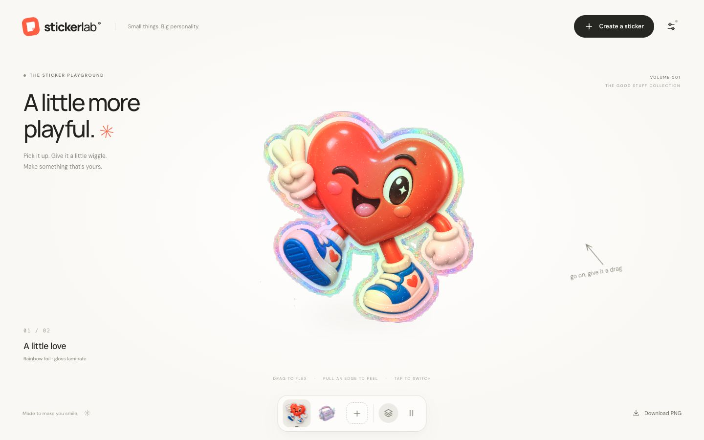

# Sticker Lab

Interactive die-cut sticker playground inspired by [Bubbbly's sticker pack](https://www.bubbbly.com/sticker-pack). Original interface, WebGL materials, and demo artwork. Vite + Three.js + a small Node server.

## Run

### Live demo / 在线体验

[Open Sticker Lab · 点击体验](https://jdb156158.github.io/3dStickerTool/)

[](https://jdb156158.github.io/3dStickerTool/)

GitHub Pages supports 3D interactions, local IMG.LY subject cutout, and PNG export. AI remix requires the Node server and is disabled in this static demo. First-time cutout downloads model assets; photos stay in your browser. Created stickers are session-only—download them before refreshing.

在线版支持 3D 交互、本地 AI 抠图和 PNG 导出；不提供需要后端的 AI 重绘。首次抠图需下载模型，图片不会上传；刷新前请下载保存作品。

### Local development

Requires Node.js 22+ and pnpm (or npm).

```sh
pnpm install
pnpm dev
```

Open the local URL shown in the terminal. For a production build:

```sh
pnpm build
pnpm start
```

The production server defaults to `http://127.0.0.1:4173`. Set `HOST=0.0.0.0 PORT=3000` when deploying behind an HTTPS reverse proxy. Deploy the Node server together with `dist`; static-only hosting supports local creation but cannot serve the AI endpoint. The server stores neither images nor keys and does not log request bodies. Keep body/header logging disabled in the deployment proxy as well.

## Use

- Drag the sticker to flex it; drag an edge to curl it; click to switch. Arrow keys switch stickers, L toggles layers, Space pauses the idle motion. Reduced-motion preferences pause idle animation initially.
- Layer view contains six independent surfaces, top to bottom: laminate, laminate adhesive, printed ink, vinyl stock, adhesive, and backing liner. Labels follow the projected position of each surface and include material thickness. Material appearances are illustrative, not a manufacturing simulation.
- **Create a sticker → Instant sticker**: upload PNG/JPEG/WebP, choose a finish and border. Local AI subject cutout is enabled by default, using IMG.LY ISNet FP16 in a browser worker. First use downloads model/runtime resources from IMG.LY (the model is approximately 80 MB); image pixels stay on the device and no API key is needed. Uncheck cutout to preserve an existing transparent PNG or create a photo sticker. Failed model loading reports an error rather than silently using colour removal. This removes backgrounds, not redraws subjects. See [third-party licensing notes](THIRD_PARTY_NOTICES.md) before publishing.
- **AI remix**: set your own OpenAI API Key, upload a reference, optionally describe the desired look, then generate. The image and prompt are sent via `/api/sticker` to the fixed OpenAI Images edits endpoint. API billing belongs to the supplied key. Defaults to `gpt-image-2.5-sunburst`, medium quality, 1024×1024, transparent PNG. Availability depends on the account's model permissions.
- **API settings**: key is held in page memory by default. Opt-in local storage remembers it on that browser; Clear Key removes it. Browser local storage is not encrypted. This BYOK demo requires trusting the host serving the page and proxy.
- **Download PNG** exports the flat transparent artwork with its border. Interactive lighting, bending, and exploded layers are viewport effects, not an animation embedded in PNG.
- Created stickers remain in the current session; download them before reloading. Failed or cancelled AI requests leave the current sticker intact. Cancelling waiting cannot guarantee the upstream request has not been billed.

## Verification

```sh
pnpm test
pnpm build
```

Tests cover API request shape, file/model validation, authorization/origin rejection, response/error mapping with a mocked upstream, and preservation of enclosed subject details during solid-background removal. A real paid API generation requires a user-supplied key and is not covered by the mock tests.

Browser checks completed at 1440×900 and 390×844: local upload and creation, material controls, layer expansion, settings persistence and key clearing. The in-app browser invoked the PNG export but did not expose a completed download event; verify file saving in a regular browser. Build and all five tests pass.

Official API reference used: [Image generation guide](https://developers.openai.com/api/docs/guides/image-generation).

## Demo artwork

`public/stickers/heart.png` and `public/stickers/cassette.png` were generated using the built-in image generation tool. Prompts and constraints are recorded in [ASSETS.md](ASSETS.md). The reference website's brand assets and source code are not bundled.
